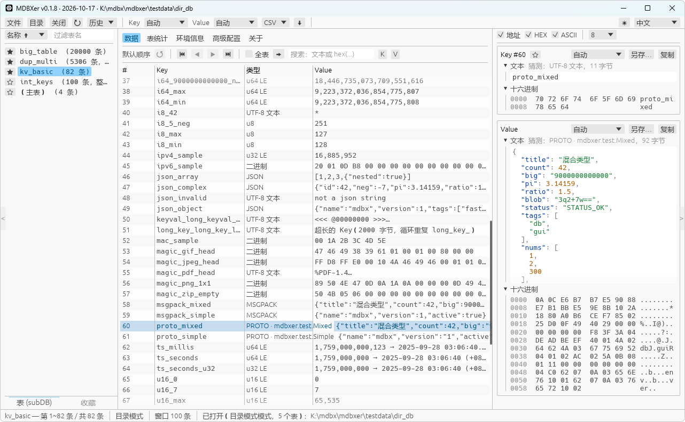

# MDBXer

[libmdbx](https://libmdbx.dqdkfa.ru/) 数据库的图形浏览工具，日常以只读方式打开；用户可显式确认执行恢复。Rust 2024 + egui 0.36 实现，单文件分发，跨平台（Windows / Linux / macOS）。

> 向 libmdbx 及其作者 Leonid Yuriev 致敬——本工具内置俄语界面（Русский）。



## 下载

预编译版本见 [GitHub Releases](https://github.com/lwq2015/mdbxer/releases)（含 Windows x86_64 / Linux x86_64 / macOS Apple Silicon），[Gitee Releases](https://gitee.com/lwq_yu/mdbxer/releases) 为镜像。macOS 仅提供 ARM 包，Intel Mac 可经 Rosetta 2 运行。

## 功能特性

### 打开方式
- **文件 / 目录 / 自动**三种模式，对应 MDBX 的 `MDBX_NOSUBDIR`
- 系统文件对话框、历史记录下拉、**拖入窗口**、命令行传路径
- 日常浏览以 `accede` 只读打开，可查看正被其他进程占用的库；只读打开失败时，用户可显式确认以读写模式触发 MDBX 恢复（可选先备份）
- 历史记录最多 20 条，同路径去重置顶，持久化到 `%APPDATA%\mdbxer\history.json`

### 数据浏览
- **锚点分页**：无需 COUNT，翻页成本与表大小无关；每页 50/100/200/500/1000 条
- **多值表（DUP_SORT）按 Key 分组**：每个 Key 只占一行，避免某 Key 值过多霸占整页
- 列头点击排序（Key 切换全局方向，其余列页内排序）、`↺` 恢复原始顺序
- 跳转定位：`hex(...)` / `0x...` / 文本 / 十进制（INTEGER_KEY 表）

### 多值导航（右栏）
- 逐值 `◀ ▶`、翻页 `⏪ ⏩`（±100）、首/末值 `⏮ ⏭`
- 序号跳转、按内容搜索（文本或字节子串，支持回绕）
- 每 100 个值一页懒加载

### 格式解析（35 种，含自动猜测）
`自动 / utf8 / utf16(LE) / utf16(BE) / gb18030 / windows-1251 / shift_jis / big5 / windows-1252 / int8 / int16 / int32 / int64 / uint8 / uint16 / uint32 / uint64 / float / double / hex / dec / binary / base64 / uuid / mac / ip / time / json / bson / msgpack / cbor / proto / yaml / toml / xml`

- **自动猜测链**：压缩容器（zstd / gzip / zlib / lz4 / bzip2 / xz / Snappy / Brotli）解压一层后继续猜测内层格式，如 `gzip → JSON`；再识别 JSON / BSON / MessagePack / CBOR / XML / YAML / TOML、可打印 UTF-8、已载入协议池时的 Protobuf、UTF-16、整数与二进制
- 命中文件魔数时附标注（PNG / JPEG / GIF / WebP / WAV / ICO / PDF / ZIP / RAR / 7z / FLAC / Ogg / MP3 / MP4 / SQLite）；表格 Auto 列对 4/6/16 字节值附 IPv4 / MAC / IPv6 解读
- `uint64` 落在 Unix 时间戳（秒/毫秒）或 FILETIME 区间时自动附本地日期；手动 `time` 格式支持 4 字节 Unix 秒
- 手动格式补齐常见场景：`gb18030` / `windows-1251` / `shift_jis` / `big5` / `windows-1252` 传统编码、`base64`、`uuid`（16 字节）、`mac`（6 字节）、`ip`（4 字节 IPv4 / 16 字节 IPv6）、`json` / `bson` / `msgpack` / `cbor` / `yaml` / `toml` / `xml` 结构化排版、`proto` 动态解码
- **Protobuf**：「载入 .proto」纯 Rust 编译（无需 protoc），按所选 message 类型解码为 JSON；协议与库的关联自动记忆、打开库时自动恢复，也可一键清除；已载入后 Auto 自动猜测类型
- 字节序 LE/BE 切换；短字节零扩展补齐并标注；长度不符的地址/时间类格式回退 hex 并标注
- 千位分隔开关、单元格字符数截断（64–4096）；格式下拉按界面语言排序，「自动」固定置顶

### 大字段分段
- 超过 64 KiB 的字段按段浏览，段内文本与 hex 只渲染当前窗口
- hex dump 三段独立开关（地址 / HEX / ASCII），行宽 4/8/16

### 统计与环境信息
- 表统计：条目数、B+树深度、分支/叶子/溢出页数、页大小、总大小、表标志
- 环境信息：文件几何、映射大小、页数、事务 ID、读者槽位等

### 多语言
- 中文 / English / Русский，顶栏右侧下拉切换，**即时生效**
- 首启按系统区域自动猜测，选择持久化到 `config.json`

### 其他
- Key/Value 复制完整解码文本、另存原始字节（不经截断/解码）
- 三栏宽度互相约束（左栏 120–320，中央区域保底 300）
- 工具栏下拉支持滚轮切换

## 构建与运行

需要 Rust 工具链（edition 2024，推荐 1.85+）。

```bash
# 开发运行
cargo run

# 发布构建（Windows 下不弹控制台）
cargo build --release

# 运行单元测试
cargo test
```

构建产物：`target/release/mdbxer`（Linux）或 `target\release\mdbxer.exe`（Windows）。

> 注意1：`mdbx-sys` 编译时需目标平台原生 C 头文件，**不支持交叉编译**，Linux 构建须在 Linux 环境进行。

> 注意2（Windows）：默认以 `+crt-static` 静态链接 MSVC 运行时（见 `.cargo/config.toml`），产物**不依赖 `vcruntime140.dll` / `ucrtbase.dll`** 等 VC 运行时，可直接拷到任意 Win10/11 上运行，无需安装 VC++ Redistributable。

## 测试数据

`examples/make_test_db.rs` 可生成功能全覆盖的测试库（`testdata/dir_db` + `testdata/file_db.mdbx`）：普通表、多值表、INTEGER_KEY 表、大字段、数值/边界值全覆盖、JSON/BSON/MessagePack/CBOR 样本（Auto 可识别）、8 种压缩容器（zstd、gzip、zlib、LZ4 frame、bzip2、xz、snappy frame、brotli）穿透样本、地址/时间戳样本、文件魔数样本、以及 Protobuf 样本。长 JSON 搜索样本 `json_search_long` 含 96 条记录，可用 `needle-amber` 测试多次命中、全部高亮和上下条导航。每次运行都会先删除并重建这两个输出，防止旧表或已删除样本残留；若数据库被 MDBXer 占用或清理/写入失败，命令会报错退出，不会伪报成功：

- Protobuf 协议 `testdata/test.proto` 由脚本自动生成，覆盖全 15 种标量（int varint / sint zigzag / fixed 定宽）、enum、repeated、嵌套消息、map（三种值型）、oneof、optional
- 样本 `proto_simple` / `proto_mixed` / `proto_scalars` / `proto_shapes` / `proto_tables` 与 UI 解码同一管线动态编码，wire 数据与 schema 自洽
- 查看方式：UI 切 proto 排版 → 「载入 .proto」选 `testdata/test.proto` → 任意 `mdbxer.test.*` 类型（或直接用 Auto 自动识别）

```bash
cargo run --example make_test_db
```

## 许可证

[Apache-2.0](LICENSE)

本项目静态链接 libmdbx（OpenLDAP Public License 2.8），相关声明见 [NOTICE](NOTICE)。

---

## 免责声明

1. **日常浏览只读**：本工具以 `Mode::ReadOnly` + `accede` 方式打开数据库，不会写入数据库。若只读打开失败，用户可以明确确认执行恢复；该流程会临时以读写模式打开数据库并可能修改文件，单文件模式可选择先创建 `.bak-recover` 备份。用户仍应在使用前自行备份重要数据。

2. **按"原样"提供**：本软件按 Apache License 2.0 的条款"按原样"分发，**不提供任何明示或暗示的担保**，包括但不限于适销性、特定用途适用性和非侵权性的担保。在任何情况下，作者或版权持有人均不对因使用本软件而产生的任何索赔、损害或其他责任负责。

3. **数据安全**：即使日常浏览以只读方式进行，MDBX 数据库文件仍可能因其他进程写入而处于不一致状态；用户确认恢复操作也可能修改文件。本工具不对数据完整性、解析准确性或用户基于本工具输出做出的决策承担责任。

4. **使用风险**：用户自行承担使用本软件的全部风险。对于因使用本软件而导致的任何直接或间接损失（包括但不限于数据丢失、业务中断、利润损失），作者不承担责任。

5. **第三方组件**：本软件依赖 libmdbx 等第三方库，各组件的许可证条款和免责声明分别适用。请在分发时保留 [LICENSE](LICENSE) 与 [NOTICE](NOTICE) 文件。
